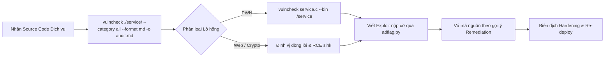

# CẨM NANG HƯỚNG DẪN SỬ DỤNG VULNCHECK (v3.0)
### Multi-Domain SAST + Binary Disassembly Analyzer + Exploit Planner (CTF / Attack & Defense)

> **Vị trí file:** `iboh26/tools/vulncheck.py`  
> **Lệnh hệ thống:** `vulncheck` (đã symlink vào `~/.local/bin/vulncheck`)

---

## 1. TỔNG QUAN CÔNG CỤ

`vulncheck` là bộ công cụ kiểm thử an ninh tĩnh (SAST) kết hợp phân tích thế trận file thực thi (Binary Posture), được tối ưu hóa đặc biệt cho các kỳ thi **Attack / Defense (A/D)** và **Whitebox CTF**:
- **Quét đa lĩnh vực (Multi-Domain):** Hỗ trợ đầy đủ 4 mảng chính: **PWN** (C/C++), **WEB** (Python, PHP, JS), **CRYPTO** (Python, C), và **REV** (Reverse Engineering / Anti-Analysis).
- **Tương quan cờ bảo vệ nhị phân (Mitigation-Aware):** Tự động đọc file ELF nhị phân (`Canary`, `NX`, `PIE`, `RELRO`, `RWX Segments`) để suy luận kịch bản khai thác đối phương sẽ áp dụng (`ret2shellcode`, `ret2win`, `ROP/ret2libc`, `GOT Overwrite`).
- **Giao diện Terminal Card v2.2:** Trích xuất đoạn mã chứa lỗi (3 dòng context), đánh dấu chính xác bằng con trỏ caret `^~~~~~`, hiển thị 4 trường thông tin hành động: **Nguyên nhân**, **Kịch bản khai thác**, **Cách vá (Remediation)** và **Tài liệu tham khảo**.
- **Đa định dạng báo cáo:** Terminal tương tác (term), chuẩn Compiler diagnostics (`--compiler` cho Vim/VS Code/CI), JSON máy đọc (automation), và Markdown hoàn chỉnh cho báo cáo kiểm thử.

---

## 1b. 🆕 PHÂN TÍCH NHỊ PHÂN & SINH EXPLOIT (v3.0)

Đưa THẲNG file nhị phân ELF vào (không cần source) — vulncheck tự làm 4 việc:

1. **Disasm & tìm lỗ hổng theo OFFSET** (radare2): quét call-site các hàm nguy hiểm
   (`gets/strcpy/strcat/sprintf/scanf/system/execve/popen/printf-fmt/read/memcpy/alloca/mprotect`)
   → báo `0x<offset> <hàm>` thay cho số dòng. Phát hiện **hàm win/backdoor** (ret2win), `/bin/sh`, format-string.
2. **MÃ GIẢ (pseudo-C)** — `--decompile` in `pdc` của hàm dính lỗ (giống IDA, không cần r2ghidra).
3. **KỊCH BẢN EXPLOIT** — tổng hợp lỗ hổng + checksec (NX/PIE/RELRO/Canary/RWX) → chiến lược xếp theo
   sao ưu tiên: ret2win → ret2shellcode → ret2libc → ROP → stack pivot → SROP → format string → heap (tcache/house).
4. **SINH SCRIPT pwnld** — `--exploit` tạo khung exploit (ret2win/ret2shellcode/ret2libc/ROP/fmt) với payload sẵn, chỉ việc đo OFFSET.

```bash
vulncheck ./service                      # ELF: offset + kịch bản + script
vulncheck ./service --decompile          # + mã giả pseudo-C
vulncheck ./service --exploit exp.py     # + sinh script pwnld ra exp.py
vulncheck service.c --bin ./service      # source + binary KẾT HỢP (đầy đủ nhất)
```

> Cần `radare2` (`r2`) cho disasm/mã giả. Không có r2 → vẫn chạy checksec + kịch bản.

**Độ phủ rule (v3.0):** PWN source +12 (system/popen/vsprintf/fprintf-fmt/memcpy-len/alloca/VLA/off-by-one/
alloc-overflow/strncpy-no-null/**UAF-double-free**) · REV +6 (xor-loop/strcmp-flag/srand-seed/custom-base64/
fork-LD_PRELOAD/SIGTRAP) · CRYPTO +7 (RSA e nhỏ/modulus nhỏ/nonce reuse/key hardcode/MT19937/single-byte XOR/
padding oracle) · WEB +7 (os.system/eval/SSTI/path-traversal/yaml/XXE/flask-debug).

---

## 2. CÀI ĐẶT & THIẾT LẬP MÔI TRƯỜNG

Công cụ đã được cấu hình sẵn trong môi trường máy thi đấu. Nếu triển khai sang máy mới hoặc vulnbox:

```bash
# 1. Cấp quyền thực thi
chmod +x iboh26/tools/vulncheck.py

# 2. Tạo symlink vào PATH
mkdir -p ~/.local/bin
ln -sf $(pwd)/iboh26/tools/vulncheck.py ~/.local/bin/vulncheck

# 3. Kiểm tra cài đặt
vulncheck --help
```

*Yêu cầu môi trường:* Python 3.8+ và thư viện `pwntools` (cho tính năng kiểm tra file nhị phân ELF):
```bash
pip install pwntools
```

---

## 3. CÚ PHÁP & DANH MỤC THAM SỐ (CLI REFERENCE)

```text
vulncheck <target> [TÙY CHỌN]
```

### Bảng tham số chi tiết:

| Tham số | Viết tắt | Ý nghĩa & Mô tả | Mặc định |
|---|---|---|---|
| `<target>` | | File mã nguồn, thư mục, **HOẶC file nhị phân ELF** (tự nhận dạng `\x7fELF`) | *(Bắt buộc)* |
| `--bin <path>` | | ELF để **phân tích SÂU** (disasm theo OFFSET + hàm win + checksec); tự ghép với source | `Tự tìm sibling` |
| `--category` | `-c` | Chỉ định lĩnh vực quét: `all`, `pwn`, `web`, `crypto`, `rev` | `all` |
| `--format` | `-f` | Định dạng xuất kết quả: `term` (màu), `gcc` (compiler), `json`, `md` | `term` |
| `--compiler` | | Viết tắt của `--format gcc` (tương thích Vim makeprg / IDE Linter) | `False` |
| `--decompile` | `--asm` | Hiện **MÃ GIẢ (pseudo-C)** của hàm dính lỗ hổng (cần `radare2`) | `False` |
| `--exploit [file]` | | Sinh **script exploit khung (pwnld)** theo kịch bản (mặc định `exploit_gen.py`) | `tắt` |
| `--no-plan` | | Không in phần **KỊCH BẢN EXPLOIT** ở cuối | `False` |
| `--out <file>` | `-o` | Lưu kết quả xuất ra file thay vì in trực tiếp ra màn hình | `stdout` |
| `--no-color` | | Tắt mã màu ANSI (phù hợp khi pipe hoặc lưu log thô) | `False` |

---

## 4. HƯỚNG DẪN SỬ DỤNG THEO TỪNG LĨNH VỰC

Trong thư mục `iboh26/tools/` đã chuẩn bị sẵn các bộ mã nguồn kiểm thử đại diện cho từng mảng:

### 4.1. 🩸 MẢNG PWN (C / C++ Memory Corruption & ELF Posture)
Chuyên trị các lỗ hổng bộ nhớ: Stack BOF, Format String, Heap UAF/Double-Free, Signedness Mismatch, Integer Overflow, Poison Null Byte, Off-by-one, TOCTOU.

```bash
# Quét mã nguồn kết hợp phân tích nhị phân (Kịch bản khai thác thực chiến)
vulncheck ./iboh26/tools/test_vuln2.c --bin ./iboh26/tools/test_vuln2

# Quét nhanh ở chế độ Compiler Linter (tương thích GCC / Clang)
vulncheck ./iboh26/tools/test_vuln2.c --compiler
```

**Ma trận Kịch bản Tấn công theo Cờ Bảo vệ Binary:**
- `NX: OFF` hoặc `RWX Segment`: Tự động kích hoạt kịch bản **`CRITICAL EXPLOIT [ret2shellcode / T1 & T5]`** (Thực thi shellcode trực tiếp trên stack, 1-shot RCE).
- `NX: ON`, `Canary: OFF`, `PIE: OFF`: Tự động kích hoạt kịch bản **`HIGH EXPLOIT [ret2win / ret2libc / T1 & T3]`** (ROP chain tĩnh ghi đè RIP).
- `Canary: ON`: Cảnh báo **`CHALLENGING SCENARIO [Canary Bypass / T4]`** (Bắt buộc leak canary trước qua lỗi phụ).
- `RELRO: Partial/None`: Với Format String hoặc Heap UAF, tự động kích hoạt kịch bản **`GOT Overwrite / T2, T6 & T10`**.
- `RELRO: Full`: Tự động chuyển kịch bản sang **`Stack / FSOP House of Apple2 / T9`**.

---

### 4.2. 🌐 MẢNG WEB (Python / PHP / JS Security SAST)
Quét toàn diện các lỗ hổng ứng dụng Web trong source code dịch vụ:
- **WEB-SQLI:** SQL Injection qua ghép chuỗi PHP (`$sql = "..." . $id`) hoặc Python f-string (`f"SELECT ... {user}"`).
- **WEB-INJ:** Command Injection / RCE qua `system()`, `shell_exec()`, hoặc `subprocess(shell=True)`.
- **WEB-DESER:** Insecure Deserialization nguy hiểm qua Python `pickle.loads()` hoặc PHP `unserialize()`.
- **WEB-SSTI:** Server-Side Template Injection qua Jinja2 `render_template_string()`.
- **WEB-SSRF:** Server-Side Request Forgery qua HTTP clients `requests.get(url)`.
- **WEB-LFI / WEB-TRAV:** Local/Remote File Inclusion và Path Traversal qua `include()`, `file_get_contents()`.
- **WEB-SECRET:** Khóa bí mật bị lộ trong mã nguồn (`JWT_SECRET`, `API_KEY`).

```bash
# Quét file Web Python
vulncheck ./iboh26/tools/test_web.py --category web

# Quét file PHP
vulncheck ./src/index.php --category web
```

---

### 4.3. 🔐 MẢNG CRYPTO (Cryptographic Misconfigurations & Weak Primitives)
Phát hiện các sai sót thiết kế thuật toán mật mã:
- **CRYPTO-MODE:** Sử dụng chế độ `AES.MODE_ECB` không an toàn (làm lộ cấu trúc bản rõ - ECB Penguin).
- **CRYPTO-STATIC-IV:** Sử dụng Vector khởi tạo (IV) tĩnh hoặc toàn số 0 trong CBC/CTR.
- **CRYPTO-KEY:** Khóa RSA độ dài yếu (< 2048 bits) dễ bị phân tích nhân tử $N = p \times q$.
- **CRYPTO-HASH:** Sử dụng hàm băm va chạm suy yếu (`MD5`, `SHA-1`).
- **CRYPTO-RNG:** Seed bộ sinh số ngẫu nhiên bằng thời gian thực `random.seed(time.time())` cho phép đoán trước chuỗi OTP/Token.
- **CRYPTO-CIPHER:** Sử dụng thuật toán cổ điển đã lỗi thời (`DES` 56-bit, `RC4`, `Blowfish`).

```bash
# Quét mã nguồn mật mã
vulncheck ./iboh26/tools/test_crypto.py --category crypto
```

---

### 4.4. 🔍 MẢNG REVERSE ENGINEERING (Anti-Analysis & Anti-Debugging)
Phân tích các bẫy làm rối và chống dịch ngược trong source code:
- **REV-ANTI-001:** Bẫy debugger Linux qua `ptrace(PTRACE_TRACEME, 0, 1, 0)`.
- **REV-ANTI-002:** Bẫy debugger Windows qua API `IsDebuggerPresent()` / PEB `BeingDebugged`.
- **REV-ANTI-003:** Đọc `/proc/self/status` kiểm tra trường `TracerPid != 0`.
- **REV-ANTI-004:** Đo chu kỳ xung nhịp CPU bằng `__rdtsc()` (Timing Check) để phát hiện breakpoint hoặc single-stepping.

```bash
# Quét các kỹ thuật chống debug
vulncheck ./iboh26/tools/test_rev.c --category rev
```

---

## 5. QUY TRÌNH TÁC CHIẾN ATTACK / DEFENSE (A/D WORKFLOW)

Khi nhận được source code dịch vụ (Vulnbox) trong trận đấu A/D:



### Bước 1: Quét toàn diện thư mục dịch vụ (Phút 0 - 2)
```bash
vulncheck ./service/ --category all --format md --out audit_report.md
```
Mở file `audit_report.md` để nắm danh sách toàn bộ các lỗ hổng Critical / High của tất cả các service (C, Python, PHP).

### Bước 2: Phân tích thế trận khai thác (Phút 2 - 5)
Chạy trực tiếp trên từng file C có đính kèm binary:
```bash
vulncheck ./service/pwn_service.c --bin ./service/pwn_service
```
Đọc ngay phần **`▶ Kịch bản`** để biết binary có thể bị ret2shellcode, ret2libc hay GOT Overwrite.

### Bước 3: Khai thác nộp cờ (Phút 5 - 15)
Sử dụng công cụ `genscr` và `adflag.py` có sẵn trong thư mục `tools/` để dựng script tấn công các đội bạn và nộp flag tự động:
```python
from pwnld import *
from adflag import submit

# Build payload theo kịch bản từ vulncheck...
io.sendline(payload)
submit(io.recvall().decode())
```

### Bước 4: Vá mã nguồn (Defense & Patching)
Làm theo đúng hướng dẫn trong trường **`▶ Cách vá`** của `vulncheck`:
- **Format String:** `printf("%s", var);`
- **Heap UAF:** Gán ngay `ptr = NULL;` sau khi `free(ptr);`
- **Integer Mismatch:** Đổi sang `size_t` và kiểm tra `if (len >= 0 && len <= MAX)`
- **SQL Injection:** Dùng prepared statements / parameterized queries.
- **Pickle Deserialization:** Chuyển sang `json.loads()`.

### Bước 5: Biên dịch gia cố phòng thủ tối đa (Compiler Hardening)
```bash
gcc -O2 \
    -fstack-protector-strong \
    -D_FORTIFY_SOURCE=2 \
    -Wformat -Wformat-security \
    -fPIE -pie \
    -Wl,-z,relro,-z,now \
    -Wl,-z,noexecstack \
    -o hardened_service service.c
```

---

## 6. DANH MỤC CÁC FILE TEST CÓ SẴN ĐỂ THỬ NGHIỆM

Bạn có thể chạy thử nghiệm ngay các file mẫu trong thư mục `iboh26/tools/`:

| File kiểm thử | Danh mục | Nội dung & Lỗ hổng kiểm tra | Lệnh chạy mẫu |
|---|---|---|---|
| [test_vuln1.c](test_vuln1.c) | PWN | Struct signed comparison mismatch & Dangling pointer | `vulncheck test_vuln1.c` |
| [test_vuln2.c](test_vuln2.c) | PWN | Micro-Broker: 8 lỗi logic phức tạp (UAF, FMT, BOF, OOB...) | `vulncheck test_vuln2.c --bin ./test_vuln2` |
| [test_web.py](test_web.py) | WEB | Flask API: SQLi f-string, Pickle RCE, SSTI, Subprocess, SSRF | `vulncheck test_web.py -c web` |
| [test_crypto.py](test_crypto.py) | CRYPTO | AES-ECB, Zero IV, RSA 1024-bit, MD5 hash, Time-seed PRNG | `vulncheck test_crypto.py -c crypto` |
| [test_rev.c](test_rev.c) | REV | Crackme: ptrace anti-debug, TracerPid status, RDTSC timing | `vulncheck test_rev.c -c rev` |
